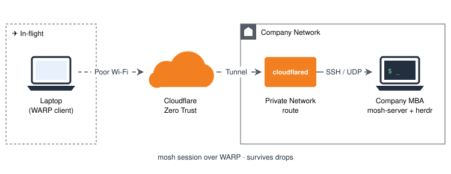
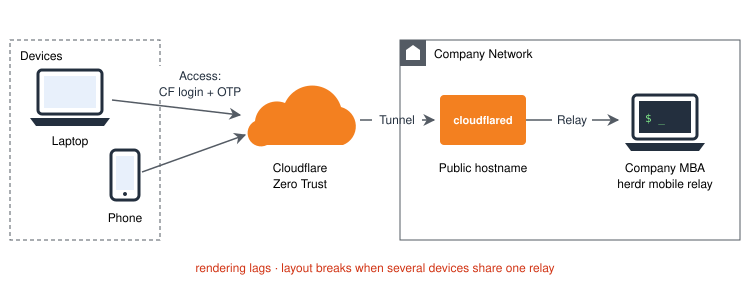
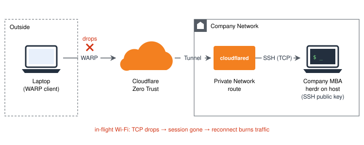
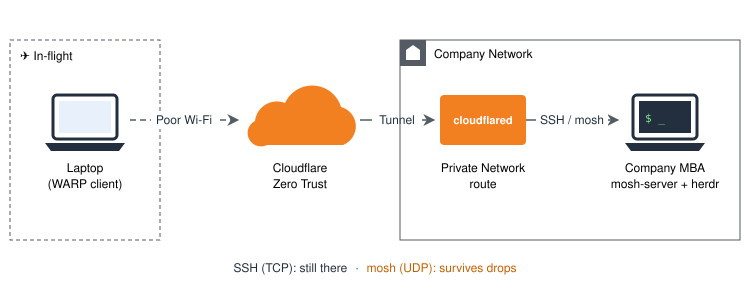

<center>在飛機上、在訊號爛到不行的地方，怎麼還能繼續工作。</center>
<!-- More -->

# Opening
COSCUP 那篇有講過，幕僚 agent 一開始就丟在雲上，原因很俗：我通勤搭公車。
先有公車，才有原則。

這次換成飛機。
我平常的工作介面是 [herdr][3]，agent 都在公司那台 MBA 上跑，我只是從外面連進去看、下指令。
為了能在外面順順地用，這套前後換了三次。

---

# 第一版：herdr mobile relay


一開始直接用 herdr 自己的 mobile relay 從外面連進去，最省事。

MBA 不可能直接開 port 到外網，所以從這時候就是用 Cloudflare Zero Trust 的 tunnel 把 relay 接出去，
前面再擋一層 Access：要連 relay 的裝置得先用 CF 帳號登入、再輸入 OTP。

- **壞在**：渲染效能很差，畫面常常卡卡的
- **更麻煩的是**：多台裝置同時連到同一個 mobile relay，layout 很容易就跑掉

---

# 第二版：SSH 進去，在 host 上開 herdr


- **改成**：直接 SSH 進 MBA，herdr 就在 host 上跑，我的終端機只負責顯示
- 渲染跟多裝置打架的問題就沒了

連線方式也跟著換成 WARP client + Private Network：

1. MBA 上跑 `cloudflared` tunnel，把它所在的內網網段宣告成 private network route
2. 我的筆電裝 WARP client，登入 Zero Trust 組織
3. WARP 打開之後，筆電就像在內網裡一樣，直接用內網 IP SSH 進去

```bash
ssh <user>@<MBA 內網 IP>
```

認證也換掉：把 CF 帳號登入 + OTP 那層拿掉，改用 SSH public key。
細節可以參考 Cloudflare 的文件<small>[[註2 Connect private networks]][2]</small>。

而且 herdr 剛好補上另外一半：SSH 管的是「連得進去」，herdr 管的是「工作不斷」。
就算連線斷了（例如筆電沒電），herdr 跟裡面的 agent 都還在 MBA 上繼續跑，下次連回去接著看就好，什麼都沒丟。

- **壞在**：遇到機上 Wi-Fi 就不行了 —— 延遲高、三不五時斷一下。網路一抖 SSH 就斷，TCP 連線一斷，session 就沒了
- **更糟的是**：重連要重新握手、重新拉畫面，重連本身就很浪費流量

---

# 第三版：再多一條路 —— mosh


SSH 還是留著，只是多加一條給爛網路用的路。

## 為什麼是 mosh
[mosh][1] 只用 SSH 做一開始的握手，之後就改走 UDP，自己管狀態同步：

- **漫遊**：IP 換了、網路斷了一陣子，回來之後 session 還在，不用重連
- **只送畫面差異**：不是把整個 byte stream 重送一遍，訊號爛的時候差很多
- **本地回顯**：打字不用等來回，延遲高的時候手感差最多

## 網路完全不用動
第二版就已經是 WARP + Private Network 了，TCP、UDP 本來就都過得去。
所以加 mosh 只要在 MBA 上裝好 mosh，連線的指令換一下就好：

```bash
mosh <user>@<MBA 內網 IP>
```

> 如果遇到 `mosh-server: command not found`，通常是 macOS 那端用 Homebrew 裝的，非互動 shell 的 PATH 沒有 `/opt/homebrew/bin`。
> 用 `mosh --server=/opt/homebrew/bin/mosh-server ...` 指定一下就好。

---

# Zero Trust 一路帶來的好處
從第一版到現在，ZT 一路都在。一開始只是為了不要開 port，用下來發現附加價值還不少：

- **MBA 完全不用對外開 port**：`cloudflared` 是從 MBA 往外連到 Cloudflare，不需要防火牆開洞、不用 port forwarding，也不用公網 IP，外面根本掃不到這台機器
- **不用自己架 VPN**：公司網路沒有對外的 VPN server 也沒差，有 tunnel 跟 WARP 就夠了
- **認證方式可以跟著換**：第一版用 CF 帳號 + OTP 擋 relay，第二版改成 SSH public key，WARP 則要先登入 Zero Trust 組織才連得上；入口都在同一個地方，換認證不用動網路架構
- **機上 Wi-Fi 不可信也沒關係**：WARP 到 Cloudflare 這一段本身就是加密的，公共 Wi-Fi 上的其他人看不到你在幹嘛
- **目標位址固定**：不管我人在哪、換了幾個網路，連的永遠都是 MBA 的內網 IP，`~/.ssh/config` 寫一次就好

---

# Reference
- [[註1 mosh: the mobile shell]][1]
- [[註2 Cloudflare Zero Trust - Connect private networks]][2]
- [[註3 herdr]][3]

<!-- This is reference link, below content would not show -->
[1]: <https://mosh.org/> (mosh: the mobile shell)
[2]: <https://developers.cloudflare.com/cloudflare-one/connections/connect-networks/private-net/> (Cloudflare Zero Trust - Connect private networks)
[3]: <https://herdr.dev> (herdr)
<!-- This is reference link, above content would not show -->
