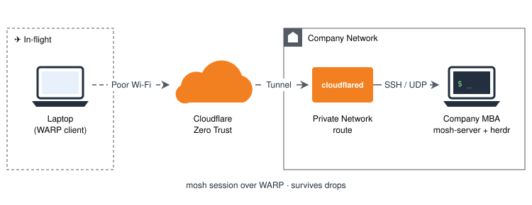
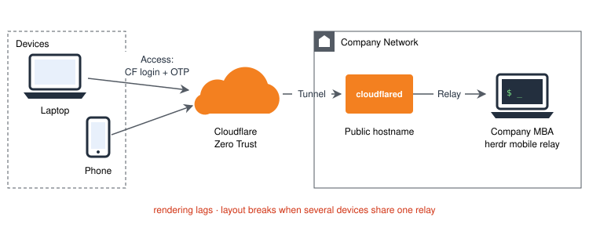
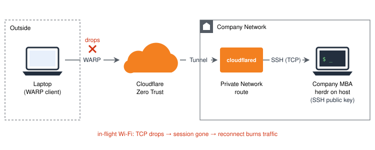
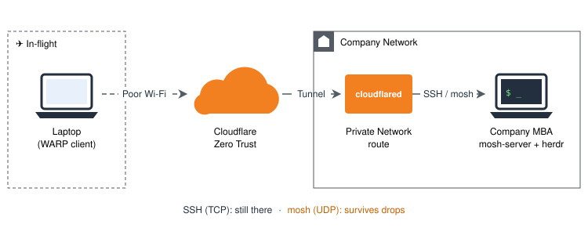

<center>How I keep working on a plane, or anywhere the network is terrible.</center>
<center>

</center>
<!-- More -->

# Opening
In my COSCUP post I mentioned my chief-of-staff agent lived in the cloud from day one, for a boring reason: I commute by bus.
The bus came first, the principle came after.

This time it's a plane.
My usual work interface is [herdr][3], and the agents run on my company MBA; I just connect in from outside to watch and give orders.
Getting that to work smoothly from outside took three rounds.

---

# Round 1: herdr mobile relay


I started with herdr's own mobile relay, the least effort way in.

The MBA is never going to expose a port to the internet, so from day one the relay went out through a Cloudflare Zero Trust tunnel,
with Access in front of it: any device connecting to the relay had to log in with a CF account and enter an OTP.

- **What broke**: rendering performance was poor, the screen often lagged
- **Worse**: with several devices connected to the same mobile relay, the layout broke easily

---

# Round 2: SSH in, run herdr on the host


- **Changed to**: SSH straight into the MBA, herdr runs on the host, my terminal only displays it
- The rendering and multi-device layout problems went away

The connection also moved to the WARP client + Private Network:

1. `cloudflared` tunnel runs on the MBA, advertising its subnet as a private network route
2. My laptop runs the WARP client, enrolled in the Zero Trust organization
3. With WARP on, the laptop is basically inside the network, SSH straight in by private IP

```bash
ssh <user>@<MBA private IP>
```

Auth changed too: I dropped the CF account login + OTP layer and use SSH public keys instead.
Check Cloudflare's docs for the details [[2]][2].

And herdr covers the other half: SSH gets me in, herdr keeps the work alive.
Even if the connection drops (laptop battery dies, say), herdr and the agents in it keep running on the MBA. Next time I connect, I pick up where I left off, nothing lost.

- **What broke**: in-flight Wi-Fi — high latency, drops every now and then. The network hiccups, SSH drops, the TCP connection is gone and so is the session
- **Worse**: every reconnect means a new handshake and redrawing the screen, reconnecting itself wastes a lot of traffic

---

# Round 3: one more way in — mosh


SSH stays, I just added another path for bad networks.

## Why mosh
[mosh][1] only uses SSH for the initial handshake, then switches to UDP and syncs the state itself:

- **Roaming**: IP changes, network gone for a while, the session is still there when it comes back, no reconnect
- **Sends screen diffs only**: not the whole byte stream again, makes a big difference on a bad link
- **Local echo**: typing doesn't wait for the round trip, which is what you feel most when latency is high

## No network changes needed
Round 2 was already WARP + Private Network, so both TCP and UDP already go through.
Adding mosh is just installing it on the MBA and changing the command:

```bash
mosh <user>@<MBA private IP>
```

> If you get `mosh-server: command not found`, it's usually because mosh was installed with Homebrew on the macOS side, and the non-interactive shell's PATH doesn't include `/opt/homebrew/bin`.
> Point to it with `mosh --server=/opt/homebrew/bin/mosh-server ...`.

---

# What Zero Trust brought along the way
ZT has been there since Round 1. I started with it just to avoid opening ports, but it brought a bunch of extras along the way:

- **The MBA exposes no ports at all**: `cloudflared` dials out from the MBA to Cloudflare, so no firewall holes, no port forwarding, no public IP — nobody outside can even scan it
- **No VPN server to run**: the company network doesn't need a public-facing VPN, the tunnel plus WARP is enough
- **Auth can change without touching the network**: CF account + OTP guarded the relay in Round 1, SSH public keys in Round 2, and WARP requires logging into the Zero Trust organization; the entry point stays the same, only the auth swaps
- **Untrusted in-flight Wi-Fi is fine**: the WARP-to-Cloudflare leg is encrypted, other people on the public Wi-Fi can't see what you're doing
- **Fixed destination**: wherever I am and however many networks I hop through, I always connect to the MBA's private IP, write `~/.ssh/config` once and done

---

# Reference
- [[1 - mosh: the mobile shell]][1]
- [[2 - Cloudflare Zero Trust - Connect private networks]][2]
- [[3 - herdr]][3]

<!-- This is reference link, below content would not show -->
[1]: <https://mosh.org/> (mosh: the mobile shell)
[2]: <https://developers.cloudflare.com/cloudflare-one/connections/connect-networks/private-net/> (Cloudflare Zero Trust - Connect private networks)
[3]: <https://herdr.dev> (herdr)
<!-- This is reference link, above content would not show -->
